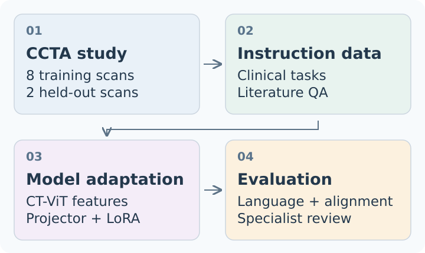

# CCTA-CHAT

**Coronary CT angiography question answering and report generation.**

CCTA-CHAT is Moira Climent's bachelor's thesis project adapting [CT-CHAT](docs/upstream.md) to coronary CT angiography (CCTA). It explores whether domain-specific instruction tuning improves answers about coronary anatomy, stenosis and CAD-RADS. The study used eight training scans and two held-out scans from Hospital de la Santa Creu i Sant Pau.



*A schematic of the thesis workflow, recreated with generic blocks by the project author. CT-CLIP supplies the CT-ViT encoder; CT-CHAT supplies the multimodal model.*

The project contributes:

- **CCTA-specific supervision:** image-linked clinical questions, structured report tasks and text-only literature QA, with explicit task markers.
- **Two adaptation strategies:** a fresh CAD adapter over a merged CT-CHAT base (FT1), and continued training of the existing CT-CHAT adapter (FT2), together with the visual projector.
- **A comparison across four models:** language metrics, semantic similarity, LLM judging and specialist report review, with alignment sensitivity checks.

## Run the evaluation example

Python 3.10+ and a CPU are sufficient. Run these commands from the repository root:

```bash
python3 -m venv .venv
source .venv/bin/activate
python -m pip install -e .
ccta-chat evaluate --references examples/references.json --predictions examples/predictions.json
```

Expected output:

```text
CCTA-CHAT | answer-only evaluation
Records: 3 | Answers: 4 | Excluded: 0
Token precision: 0.875000
Token recall:    0.750000
Token F1:        0.791667
Aggregation: macro-average over turns (lowercase whitespace-token sets)
Synthetic fixture: illustrative; not thesis results.
```

The independently authored fixture uses colours and shapes. It includes a short answer, a two-turn dialogue and the same question under two different synthetic scan IDs. Predictions are deliberately reordered: alignment uses record and turn IDs, verifies scan identity and checks prompt equality. Duplicate IDs, missing answers and conflicting prompts fail with a clear error.

The score compares **assistant answers only**. Repeated words count once; case is ignored; punctuation is preserved. Precision, recall and F1 are averaged across the four turns. These illustrative values are separate from the thesis results.

The evaluated CAD weights and clinical data are not distributed in this release. Optional [preparation, encoding, training and inference commands](docs/methods.md#use-the-model-integration) accept locally supplied artifacts; the quickstart needs none of them and downloads no model.

## Headline result

**FT1 achieved the highest language scores in the thesis comparison: BLEU-1 0.280, ROUGE-L 0.297 and CIDEr 1.009 across 627 answers in 252 conversations.** Clinical examples cover two held-out scans. FT1 remained first in the prompt-alignment sensitivity analyses. These results describe this study; language similarity does not establish clinical accuracy or performance on a broader population.

Read the [methods and intended FT1/FT2 configurations](docs/methods.md), [results and sensitivity analyses](docs/results.md), and [changes relative to CT-CHAT](docs/upstream.md).

## Develop

```bash
python -m unittest discover -s tests -v
ccta-chat prepare --input examples/references.json --output outputs/prepared.json
```

The base install has no runtime dependencies. Optional dependencies are defined once in `pyproject.toml`; Python 3.11 is recommended for the pinned model integration. CPU tests exercise alignment and preparation. Optional tests exercise synthetic feature insertion, projector/LoRA gradients and adapter restoration without downloading weights.

## Credits and use

CT-CHAT and CT-CLIP were developed by Hamamci and colleagues. Shared model machinery is pinned to CT-CHAT commit [`33c9b97`](https://github.com/ibrahimethemhamamci/CT-CHAT/tree/33c9b973bf1babb3b79b5ffd8ae45948e758a3f2); the CCTA adaptation and maintained evaluation package are presented here as a standalone project. See the [upstream map](docs/upstream.md) and [third-party notices](THIRD_PARTY_NOTICES.md) for attribution and license scope.
