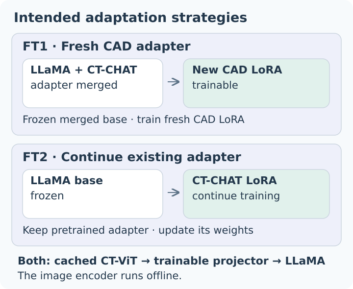

# Methods and implementation

CCTA-CHAT adapts the chest-CT workflow of CT-CHAT to coronary CT angiography. The thesis compared two LoRA adaptation strategies and evaluated coronary disease questions and generated reports. This maintained release provides preparation, encoding, model integration and evaluation commands; thesis results are reported separately on the [results page](results.md).

## Study and supervision

The cohort comprised ten CCTA examinations from Hospital de la Santa Creu i Sant Pau: eight training cases and two held-out cases. The training set contained four CAD-RADS 1 and four CAD-RADS 5 cases. Clinical supervision came from specialist reports and structured annotations, initially comprising 865 attributes. Spanish source material was cleaned and converted into English instruction data.

Instruction tasks included short answers, multiple-choice questions, free responses, descriptions, multi-turn conversations and structured report generation. Literature supplied general theoretical questions. The thesis reports 56,688 theoretical QA pairs from 10,000 articles; these are reported corpus totals rather than counts of independently verified image examples in this public package.

`ccta-chat prepare` accepts curated English QA with explicit `record_id`, `scan_id`, `split`, `task` and turn IDs. It preserves IDs and adds the CT-CHAT task marker. For image records it inserts **one `<image>` token** and `<provided>` at the first turn. `<image>` inserts projected visual features; `<provided>` is an instruction in the conversation template. Text-only literature records use `image: null` and retain `article_id`. No patient scan is randomly assigned to literature.

The supported tasks are `short_answer`, `long_answer`, `multiple_choice` and `report_generation`; descriptions, free responses and conversations use the long-answer format. The example JSON files illustrate the field structure. Add an `image` filename only when a corresponding cached feature exists. Preparation assumes the input QA has already been checked against its source; schema validation does not verify medical correctness.

The article path is explicit:

```bash
ccta-chat retrieve-articles --query 'coronary CT angiography CAD-RADS' --limit 10 --split train --output outputs/articles.json
ccta-chat generate-qa --input outputs/articles.json --model /path/to/local/instruction-model --output outputs/article-qa.json
ccta-chat prepare --input outputs/article-qa.json --output outputs/article-training.json
```

Retrieval uses PMC, preserves article IDs and permission text, and extracts nested XML text. Generation follows the thesis generator's title plus first **4,000 body characters**, requesting five educational pairs per article. It uses a local model and JSON format checks. Split articles by ID before generation and inspect article-specific reuse terms when sharing any derived material.

## Cached visual features

CT-CLIP's CT-ViT encoder runs offline. The selected CCTA profile uses target spacing **0.35 × 0.35 × 0.30 mm**, clips to **−100…800 HU**, maps the window to **[0,1]**, and centre-crops/pads to **480 × 480 × 240 voxels**, using −1 padding. Orientation follows the NIfTI voxel axes. The public encoder reads header spacing by default and permits an explicit three-axis override. Nibabel applies stored NIfTI intensity scaling once.

The encoder writes NPZ key `arr` with shape `[1,Z,X,Y,512]`. Training strips the leading singleton and batches features as `[B,Z,X,Y,512]`. CT-CHAT flattens the spatial/temporal grid, applies attention pooling to 256 queries and an MLP projector, then inserts the resulting visual tokens into the LLaMA input. Image-free prompts insert no visual tokens. **An image filename by itself does not insert visual features.**

Each encoded file has a provenance sidecar containing input, encoder-weight and source fingerprints, spacing, preprocessing and output hash. `--reuse` requires all of these to match. A missing or mismatched sidecar produces an error. The native crop is not an anatomical localization method; check scan coverage before clinical experiments.

## Intended FT1 and FT2 configurations



*Intended configurations. Generic schematic recreated for CCTA-CHAT from the thesis training diagrams; no clinical imagery is included.*

| Strategy | Language-model initialization | Trainable components |
|---|---|---|
| FT1 | LLaMA with the pretrained CT-CHAT adapter already merged; create a fresh CAD LoRA | Fresh CAD LoRA + visual projector |
| FT2 | LLaMA base and the existing pretrained CT-CHAT LoRA loaded as a trainable adapter | Existing CT-CHAT LoRA + visual projector |

The author obtained pretrained CT-CHAT resources through the CT-RATE Hugging Face repository. FT2 was designed to continue the existing CT-CHAT adapter. **Adapter initialization, learning-rate warmup and Trainer resume are separate controls.** The maintained FT2 implementation restores an existing adapter with `is_trainable=True`, checks tensor keys/shapes/values and preserves its saved rank and scaling. It never silently converts rank 128 into rank 64. A requested rank that differs from the supplied adapter is rejected.

Both release strategies explicitly enable LoRA and projector parameters after freezing the remaining language model. CT-ViT remains outside the training graph. The trainer supervises assistant spans within each conversation, masks prompts, reserves space for the 256 image tokens and preserves mixed text/image batch positions. Saved initialization metadata records artifact hashes, trainable counts, scheduler settings and the explicit resume choice.

| Setting | Thesis/template setting | Maintained configuration |
|---|---|---|
| CAD LoRA | Rank 64, alpha 16; dropout 0.05 | FT1 uses 64/16/0.05; FT2 reads the supplied adapter config |
| Epochs / batch / accumulation | 3 / 2 per device / 4 | 3 / 2 / 4 |
| LR schedule / warmup | Cosine / launcher warmup ratio 0.03 | Cosine / 0.03 |
| Learning rate | Thesis and available templates: 2e-5 | 2e-5 |
| Completed candidate job logs | Peak LR 5e-5 for jobs 359841 and 359842 | Configurable; current configs do not substitute for job logs |
| Sequence limit | Available FT1 template inherits 512; FT2 specifies 1280 | Explicit 1280 for both strategies |

The completed logs show an initial LR ramp and three-epoch completion. The numeric warmup ratio 0.03 is attributed to the launcher. The experiments ran on Pirineus (Slurm). Training-run metadata and current release validation are different evidence from the saved thesis predictions; [results](results.md) identifies how each reported metric was obtained.

## Use the model integration

Use Python 3.11 for the pinned optional dependencies. Keep the shared model machinery in a **separate CT-CHAT checkout**:

```bash
python -m pip install -e '.[model,imaging]'
git clone https://github.com/ibrahimethemhamamci/CT-CHAT.git /path/to/CT-CHAT
git -C /path/to/CT-CHAT checkout 33c9b973bf1babb3b79b5ffd8ae45948e758a3f2
ccta-chat integrate --checkout /path/to/CT-CHAT
```

`integrate` accepts a clean checkout, applies the packaged patch and verifies ten module fingerprints. Model commands verify those fingerprints again and import that explicit checkout. They reject a different `llava` installation already loaded in the process. The integration retains the upstream LLaMA and attention-pooling/MLP projector implementations; [the change map](upstream.md) describes the small patch.

For the external encoder, use the CT-CLIP source at release dependency revision `a2a155c601987820433c01db69b64d701d3d229d`:

```bash
git clone https://github.com/ibrahimethemhamamci/CT-CLIP.git /path/to/CT-CLIP
git -C /path/to/CT-CLIP checkout a2a155c601987820433c01db69b64d701d3d229d
python -m pip install /path/to/CT-CLIP/transformer_maskgit
ccta-chat encode --input /path/to/volume.nii.gz --output outputs/volume.npz \
  --encoder-source /path/to/CT-CLIP/transformer_maskgit \
  --encoder-weights /path/to/clip_visual_encoder.pth
```

This pins the release dependency; it is not a statement of the historical installation revision. The explicit source directory must contain `transformer_maskgit/__init__.py`. `--spacing X Y Z` overrides header spacing. Encoding requires sufficient memory for the resampled volume and CT-ViT.

Training and inference require these local artifacts:

| Argument | Artifact |
|---|---|
| `--base` | Full LLaMA/CT-CHAT base directory with matching config and weight shards; FT1 uses an already merged CT-CHAT base |
| `--tokenizer` | Matching tokenizer, including CT-CHAT task tokens and the same number of embedding rows as the base |
| `--projector` | `non_lora_trainables.bin` or safetensors file containing every `mm_projector` tensor |
| `--adapter` | Existing LoRA directory for FT2 or inference, including config and adapter tensors |
| `--features` | Directory of NPZ features from the selected encoder profile |
| `--data` | Prepared conversation JSON produced by `prepare` |
| `--base-provenance` | JSON describing base origin and `config_sha256`; FT1 requires `kind: "ctchat-merged-base"` |

For FT1, export the original CT-CHAT adapter into a merged base:

```bash
ccta-chat merge-base --backend /path/to/CT-CHAT --base /path/to/llama-base \
  --adapter /path/to/ctchat-adapter --tokenizer /path/to/tokenizer \
  --projector /path/to/non_lora_trainables.bin --output outputs/ctchat-merged-base
```

This writes a full model, tokenizer and `base-provenance.json` containing `kind`, `config_sha256` and merge-input hashes. For FT2, provide a base provenance JSON with `kind: "llama-base"`, its source model/revision and the SHA-256 of `config.json`. The trainer additionally fingerprints the actual local base, adapter, projector and tokenizer artifacts. These fingerprints are saved alongside the run, rather than inferred from directory names.

```bash
ccta-chat train --config configs/ft2.json --backend /path/to/CT-CHAT \
  --base /path/to/llama-base --base-provenance /path/to/base-provenance.json \
  --adapter /path/to/ctchat-adapter --tokenizer /path/to/tokenizer \
  --projector /path/to/non_lora_trainables.bin --data /path/to/prepared.json \
  --features /path/to/features --output outputs/ft2

ccta-chat infer --backend /path/to/CT-CHAT --base /path/to/llama-base \
  --adapter outputs/ft2 --tokenizer outputs/ft2 \
  --projector outputs/ft2/non_lora_trainables.bin --features /path/to/features \
  --input /path/to/questions.json --output outputs/answers.json
```

For FT1, use `configs/ft1.json`, supply the merged base and omit `--adapter`. For a deliberate Trainer restart, supply `--resume /path/to/checkpoint-N`; no output-directory auto-resume occurs. For CPU development, select `--device cpu --dtype float32`. Model commands use local artifacts only. Inference accepts the same ID/turn schema as the example, with optional `image` filenames and no pre-inserted markers. Generated output retains original question text and IDs; generation is deterministic and passes an attention mask.

## Evaluation protocols

The default `evaluate` command aligns by record/turn ID, verifies scan identity and exact prompt text, and scores assistant answers. It fails rather than silently pairing conflicting rows. Lowercase whitespace-token **sets** define precision/recall/F1; punctuation is retained. The score is a macro-average across turns.

Optional scorers:

```bash
python -m pip install -e '.[coco,semantic]'
ccta-chat coco --references /path/to/references.json --predictions /path/to/predictions.json
ccta-chat semantic --references /path/to/references.json --predictions /path/to/predictions.json --bert-model /path/to/local/roberta-large
ccta-chat judge --references /path/to/references.json --predictions /path/to/predictions.json --model /path/to/local/judge --output outputs/judge.json
```

COCO evaluation computes BLEU-1, ROUGE-L and CIDEr. METEOR on the results page is thesis-reported; this command does not silently replace its scorer. Semantic evaluation produces nine ROUGE-L/token/BERT columns and requires a local RoBERTa-large model (layer 17, no IDF or baseline rescaling). `--legacy-record` explicitly selects the historical **positional, whole-record** extraction and original nested schemas for protocol comparison. The maintained answer-only mode uses the public ID schema. Historical workstation evaluation was run from the outer evaluation directory; the release preserves the nine-column protocol and omits the later heuristic GREEN extension.

The release judge saves full question/reference/answer triplets, model-config fingerprint and rationale. It is a new judging run, separate from aggregating the thesis's stored judge scores.

## Validation scope

The clean CPU quickstart and preparation/alignment checks run without model dependencies. The optional model suite uses random tiny LLaMA weights and synthetic cached features to check image-token insertion, visual-feature influence, mixed batches, nonzero LoRA/projector gradients and exact adapter restoration. A two-strategy CPU training-and-inference smoke run also completed with synthetic artifacts. These checks establish software behavior; they do not measure clinical performance.

Run optional tests after integration:

```bash
CCTA_CHAT_BACKEND=/path/to/CT-CHAT python -m unittest discover -s tests -v
```

Full-scale encoding, generation, judging and training require the artifact sets described above. The [README](../README.md) quickstart remains independent of those commands.
