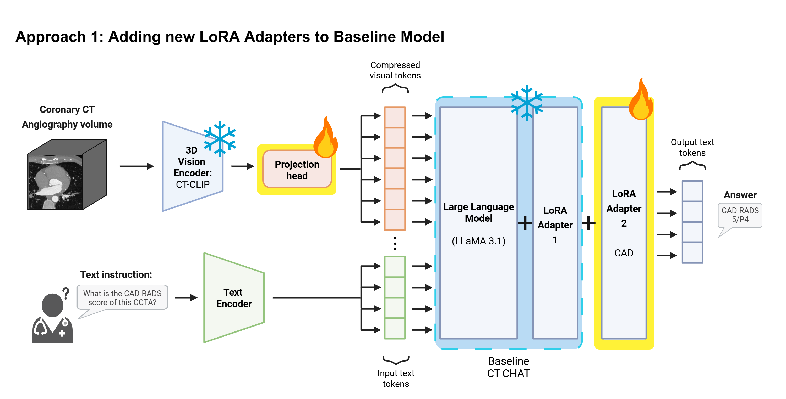
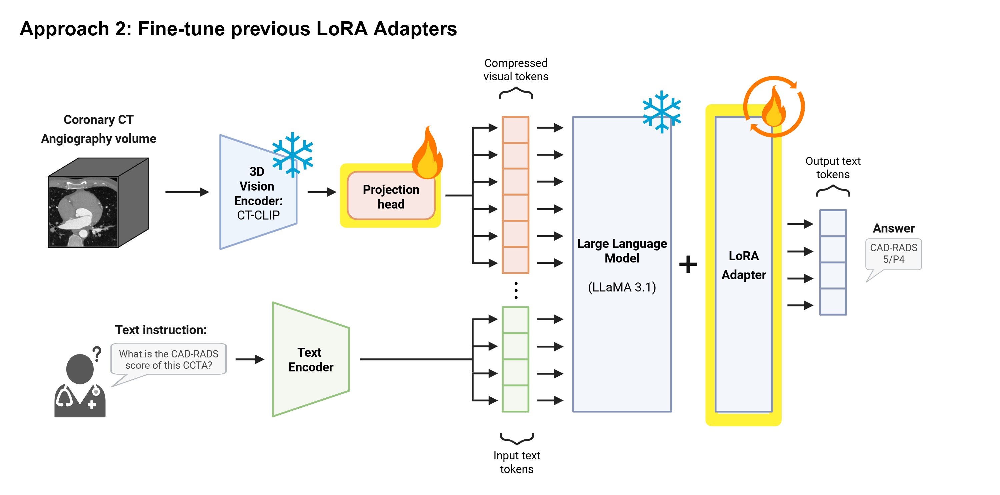

# Methods

I adapted CT-CHAT to answer coronary CT angiography questions and generate reports. The pipeline combines clinical and literature-based instruction data with cached scan features, then trains LoRA adapters and the visual projector. This page follows that data flow and explains the commands for each step.

## Study and supervision

I used ten CCTA examinations from Hospital de la Santa Creu i Sant Pau: eight for training and two held out for evaluation. The training set contained four CAD-RADS 1 and four CAD-RADS 5 cases. I prepared English supervision from Spanish specialist reports and structured annotations, initially comprising 865 attributes.

I combined short answers, multiple-choice questions, free responses, descriptions, multi-turn conversations and structured report generation with general theoretical questions from the literature. The thesis reported 56,688 theoretical QA pairs from 10,000 articles; those literature pairs are distinct from the image-linked clinical examples.

## Data preparation

`ccta-chat prepare` accepts curated English QA with explicit `record_id`, `scan_id`, `split`, `task` and turn IDs. It preserves IDs and adds the CT-CHAT task marker. For image records it inserts **one `<image>` token** and `<provided>` at the first turn. `<image>` inserts projected visual features; `<provided>` is an instruction in the conversation template. Text-only literature records use `image: null` and retain `article_id`.

The supported tasks are `short_answer`, `long_answer`, `multiple_choice` and `report_generation`; descriptions, free responses and conversations use the long-answer format. The example JSON files illustrate the field structure. Add an `image` filename only when a corresponding cached feature exists. Preparation assumes the input QA has already been checked against its source; schema validation does not verify medical correctness.

Try preparation with the synthetic example:

```bash
ccta-chat prepare --input examples/references.json --output outputs/prepared.json
```

To prepare literature QA:

```bash
ccta-chat retrieve-articles --query 'coronary CT angiography CAD-RADS' --limit 10 --split train --output outputs/articles.json
ccta-chat generate-qa --input outputs/articles.json --model /path/to/local/instruction-model --output outputs/article-qa.json
ccta-chat prepare --input outputs/article-qa.json --output outputs/article-training.json
```

Retrieval uses PMC, preserves article IDs and permission text, and extracts nested XML text. Generation follows the thesis generator's title plus first **4,000 body characters**, requesting five educational pairs per article. It uses a local model and JSON format checks. Split articles by ID before generation and inspect article-specific reuse terms when sharing any derived material.

## Cached visual features

CT-CLIP's CT-ViT encoder runs offline. The CCTA preprocessing profile uses target spacing **0.35 × 0.35 × 0.30 mm**, clips to **−100…800 HU**, maps the window to **[0,1]**, and centre-crops/pads to **480 × 480 × 240 voxels**, using −1 padding. Orientation follows the NIfTI voxel axes. The encoder reads header spacing by default and accepts a three-axis override. Nibabel applies stored NIfTI intensity scaling once.

The encoder writes NPZ key `arr` with shape `[1,Z,X,Y,512]`. Training strips the leading singleton and batches features as `[B,Z,X,Y,512]`. CT-CHAT flattens the spatial/temporal grid, applies attention pooling to 256 queries and an MLP projector, then inserts the resulting visual tokens into the LLaMA input. Image-free prompts insert no visual tokens. **An image filename by itself does not insert visual features.**

Each encoded file has a provenance sidecar containing input, encoder-weight and source fingerprints, spacing, preprocessing and output hash. `--reuse` requires all of these to match. A missing or mismatched sidecar produces an error. The native crop is not an anatomical localization method; check scan coverage before clinical experiments.

## Fine-tuning strategies

I compared two ways to adapt CT-CHAT while training the projector that connects scan features to the language model.

### FT1: train a fresh adapter

FT1 merges the original CT-CHAT adapter into the LLaMA base and freezes that combined model. It then trains a fresh CAD LoRA adapter alongside the projector. The image encoder stays frozen and supplies cached features.

[](figures/training-ft1.png)

*From Moira Climent Gispert’s bachelor’s thesis (2025).*

### FT2: continue an existing adapter

FT2 continues training an existing CT-CHAT LoRA adapter on coronary CT angiography data. The training code loads the supplied adapter, preserves its rank and scaling, and updates it alongside the visual projector. The default configuration uses a cosine learning-rate schedule with warmup over the first 3% of training steps.

[](figures/training-ft2.png)

*From Moira Climent Gispert’s bachelor’s thesis (2025).*

The pretrained CT-CHAT model is hosted through the CT-RATE Hugging Face repository. In the software, FT2 loads the adapter with `is_trainable=True` and checks its tensor keys, shapes and values. Its saved configuration determines the rank and scaling; requesting a different rank produces an error.

Both strategies enable the LoRA and projector parameters after freezing the rest of the language model. The trainer supervises assistant answers and masks prompt tokens. It reserves space for the 256 projected image tokens and preserves the positions of image and text-only records within a batch.

### Public configuration defaults

| Setting | FT1 (`configs/ft1.json`) | FT2 (`configs/ft2.json`) |
|---|---|---|
| Adapter initialization | Fresh CAD adapter over a merged CT-CHAT base | Existing CT-CHAT adapter |
| LoRA rank | 64 | Preserved from the supplied adapter |
| LoRA alpha / scaling | 16 | Preserved from the supplied adapter |
| LoRA dropout | 0.05 | Preserved from the supplied adapter |
| Trainable components | Fresh adapter + projector | Supplied adapter + projector |
| Learning rate | 2e-5 | 2e-5 |
| Scheduler / warmup | Cosine / first 3% of steps | Cosine / first 3% of steps |
| Epochs | 3 | 3 |
| Batch size per device / gradient accumulation | 2 / 4 | 2 / 4 |
| Sequence limit | 1280 | 1280 |

These are the defaults consumed by the public training commands. The [results page](results.md) reports the measured thesis comparison. Each new run saves its effective settings, model-file hashes and trainable parameter counts.

## Use the model integration

Use Python 3.11 for the pinned optional dependencies. Keep the shared model machinery in a **separate CT-CHAT checkout**:

```bash
python -m pip install -e '.[model,imaging]'
git clone https://github.com/ibrahimethemhamamci/CT-CHAT.git /path/to/CT-CHAT
git -C /path/to/CT-CHAT checkout 33c9b973bf1babb3b79b5ffd8ae45948e758a3f2
ccta-chat integrate --checkout /path/to/CT-CHAT
```

`integrate` accepts a clean checkout, applies the packaged patch and verifies ten module fingerprints. Model commands verify those fingerprints again and import that explicit checkout. They reject a different `llava` installation already loaded in the process. The integration retains the upstream LLaMA and attention-pooling/MLP projector implementations; [the change map](upstream.md) describes the small patch.

For the external encoder, use the CT-CLIP source at release dependency revision `a2a155c601987820433c01db69b64d701d3d229d`:

```bash
git clone https://github.com/ibrahimethemhamamci/CT-CLIP.git /path/to/CT-CLIP
git -C /path/to/CT-CLIP checkout a2a155c601987820433c01db69b64d701d3d229d
python -m pip install /path/to/CT-CLIP/transformer_maskgit
ccta-chat encode --input /path/to/volume.nii.gz --output outputs/volume.npz \
  --encoder-source /path/to/CT-CLIP/transformer_maskgit \
  --encoder-weights /path/to/clip_visual_encoder.pth
```

The source directory must contain `transformer_maskgit/__init__.py`. `--spacing X Y Z` overrides header spacing. Encoding requires sufficient memory for the resampled volume and CT-ViT.

Training and inference require the following local files:

| Argument | Required files |
|---|---|
| `--base` | Full LLaMA/CT-CHAT base directory with matching config and weight shards; FT1 uses an already merged CT-CHAT base |
| `--tokenizer` | Matching tokenizer, including CT-CHAT task tokens and the same number of embedding rows as the base |
| `--projector` | `non_lora_trainables.bin` or safetensors file containing every `mm_projector` tensor |
| `--adapter` | Existing LoRA directory for FT2 or inference, including config and adapter tensors |
| `--features` | Directory of NPZ features from the selected encoder profile |
| `--data` | Prepared conversation JSON produced by `prepare` |
| `--base-provenance` | JSON describing base origin and `config_sha256`; FT1 requires `kind: "ctchat-merged-base"` |

For FT1, export the original CT-CHAT adapter into a merged base:

```bash
ccta-chat merge-base --backend /path/to/CT-CHAT --base /path/to/llama-base \
  --adapter /path/to/ctchat-adapter --tokenizer /path/to/tokenizer \
  --projector /path/to/non_lora_trainables.bin --output outputs/ctchat-merged-base
```

This writes a full model, tokenizer and `base-provenance.json` containing `kind`, `config_sha256` and merge-input hashes. For FT2, provide a base provenance JSON with `kind: "llama-base"`, its source model/revision and the SHA-256 of `config.json`. The trainer additionally fingerprints the actual local base, adapter, projector and tokenizer artifacts. These fingerprints are saved alongside the run, rather than inferred from directory names.

```bash
ccta-chat train --config configs/ft2.json --backend /path/to/CT-CHAT \
  --base /path/to/llama-base --base-provenance /path/to/base-provenance.json \
  --adapter /path/to/ctchat-adapter --tokenizer /path/to/tokenizer \
  --projector /path/to/non_lora_trainables.bin --data /path/to/prepared.json \
  --features /path/to/features --output outputs/ft2

ccta-chat infer --backend /path/to/CT-CHAT --base /path/to/llama-base \
  --adapter outputs/ft2 --tokenizer outputs/ft2 \
  --projector outputs/ft2/non_lora_trainables.bin --features /path/to/features \
  --input /path/to/questions.json --output outputs/answers.json
```

For FT1, use `configs/ft1.json`, supply the merged base and omit `--adapter`. Use `--resume /path/to/checkpoint-N` to restart a run with its saved adapter, projector, optimizer and scheduler state. For CPU development, select `--device cpu --dtype float32`. Model commands load local files only. Inference accepts the same ID/turn schema as the example, with optional `image` filenames and no pre-inserted markers. Generated output retains original question text and IDs; generation is deterministic and passes an attention mask.

## Evaluation protocols

The default `evaluate` command matches record and turn IDs, verifies scan identity and exact prompt text, and scores assistant answers only. Missing IDs, duplicate IDs or conflicting questions produce an error before scoring.

The synthetic example contains a short answer, a two-turn dialogue and the same question under two different synthetic scan IDs. Its predictions are deliberately reordered. This checks that alignment follows IDs rather than file order or question wording.

Token precision, recall and F1 use lowercase whitespace-token **sets**: repeated words count once, case is ignored and punctuation is retained. Each metric is calculated for each answer and then macro-averaged across turns. The four-answer example gives token F1 **0.791667**; it is a software demonstration, separate from the thesis scores.

Optional scorers:

```bash
python -m pip install -e '.[coco,semantic]'
ccta-chat coco --references /path/to/references.json --predictions /path/to/predictions.json
ccta-chat semantic --references /path/to/references.json --predictions /path/to/predictions.json --bert-model /path/to/local/roberta-large
ccta-chat judge --references /path/to/references.json --predictions /path/to/predictions.json --model /path/to/local/judge --output outputs/judge.json
```

COCO evaluation computes BLEU-1, ROUGE-L and CIDEr. METEOR on the results page is thesis-reported and is not computed by this command. Semantic evaluation produces nine ROUGE-L/token/BERT columns and requires a local RoBERTa-large model (layer 17, no IDF or baseline rescaling). `--legacy-record` explicitly selects the historical **positional, whole-record** extraction and original nested schemas for protocol comparison. The answer-only mode uses the ID schema shown in the example. Neither mode computes GREEN.

The `judge` command saves each question, reference, answer and rationale together with the judge model’s configuration hash. Running it produces new scores; the thesis judge means on the results page summarize the stored scores from that study.

## Tests

A synthetic training test checks that FT2 loads the supplied adapter weights exactly and that both the adapter and the projector receive gradients.

The CPU tests check evaluation alignment and data preparation without model dependencies. Optional tests use a small randomly initialized LLaMA model and synthetic scan features to check image-token insertion, the effect of those features on model output, mixed batches and cache reuse. Both FT1 and FT2 also completed a synthetic CPU training-and-inference test. These tests verify the public code’s behavior; clinical performance is reported separately in Results.

Run optional tests after integration:

```bash
CCTA_CHAT_BACKEND=/path/to/CT-CHAT python -m unittest discover -s tests -v
```

The [README example](../README.md#try-the-evaluator) runs without the optional model files or dependencies.
